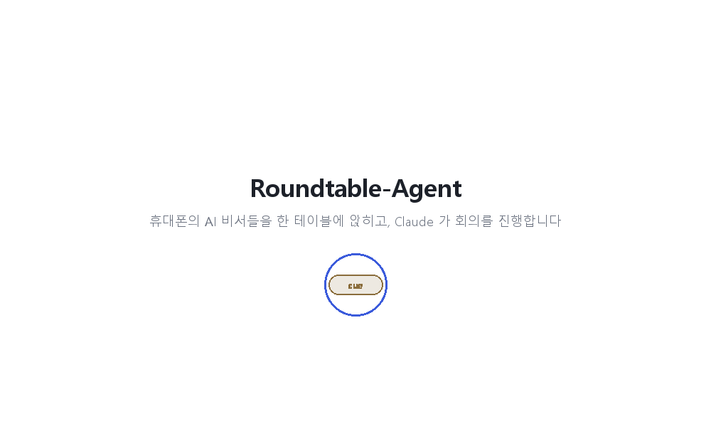
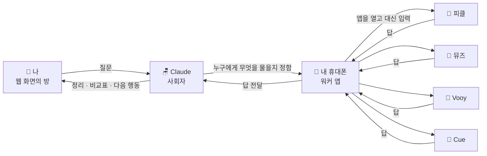
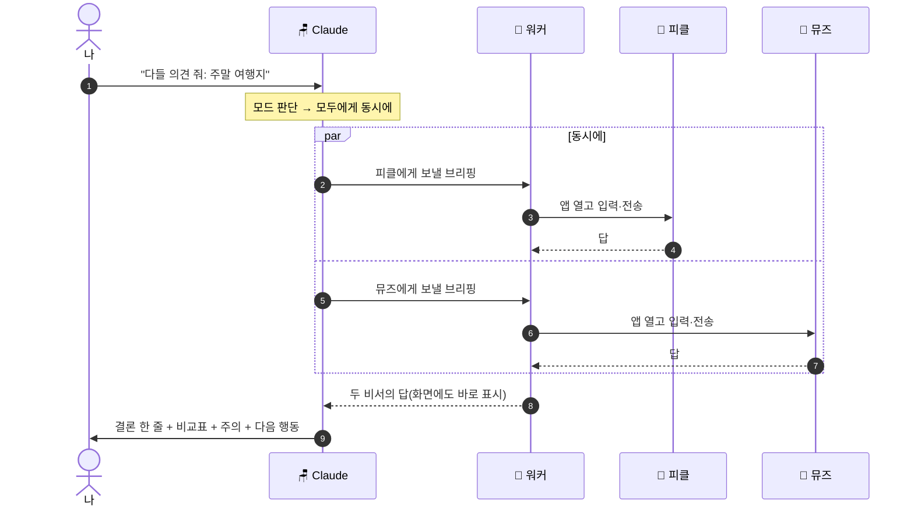
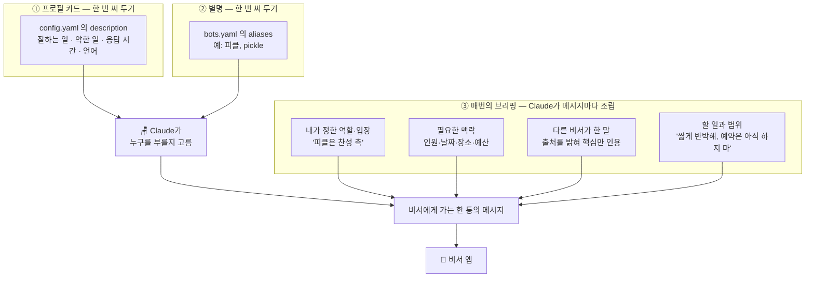
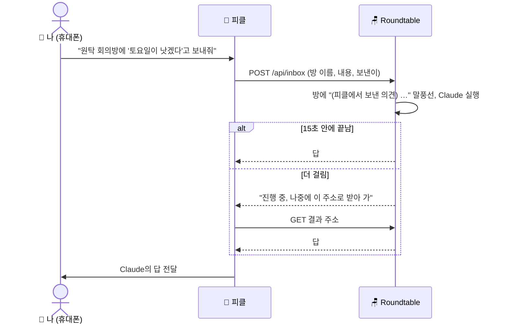
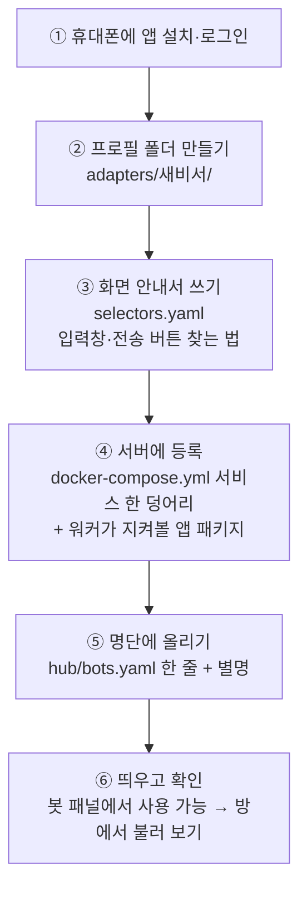
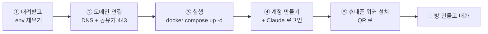
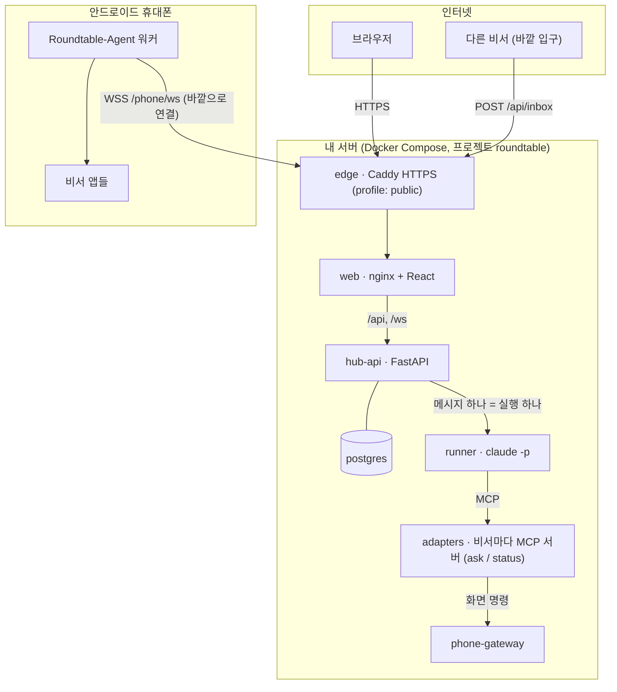

<div align="center">

# 🪑 Roundtable-Agent

**내 AI 비서들을 원탁에 앉히고, Claude가 사회를 봅니다.**

피클·뮤즈·Vooy·Cue처럼 따로 노는 AI 비서 앱들에게 한 번에 묻고, 서로 의견을 주고받게 하고,<br/>
Claude가 그 내용을 한 장으로 정리해 줍니다. 비서들은 내 휴대폰 속 앱 그대로 씁니다.

[English](README.md) · 한국어

<br/>
<sub>실제로 돌린 두 흐름을 다시 그린 시연입니다. ① 네 비서에게 한 번에 묻고 Claude 가 정리, ② 휴대폰의 비서(피클)가 허브의 방을 골라 일을 맡기고 답을 받아 감(<a href="#4-다른-비서가-방에-말-걸게-하기">4장</a>). 비서 별명·이름·계정은 지웠고, 걸린 시간은 줄였습니다.</sub>

</div>

---

## 목차

1. [무엇을 할 수 있나요](#1-무엇을-할-수-있나요)
2. [어떻게 돌아가나요](#2-어떻게-돌아가나요)
3. [비서에게 정체성 심어 주기](#3-비서에게-정체성-심어-주기)
4. [다른 비서가 방에 말 걸게 하기](#4-다른-비서가-방에-말-걸게-하기)
5. [새 앱(비서) 추가하기](#5-새-앱비서-추가하기)
6. [설치하기](#6-설치하기)
7. [안전장치](#7-안전장치)
8. [개발자용](#8-개발자용)

---

## 1. 무엇을 할 수 있나요

웹 화면의 **방**에 평소 말하듯 쓰면 됩니다. 어떤 비서를 부를지는 Claude가 정합니다.

| 이렇게 말하면 | 일어나는 일 |
|---|---|
| "내일 강남 점심 2명 갈 만한 곳 찾아줘" | 가장 잘할 비서 하나에게 묻고 정리 |
| "다들 의견 줘: 이번 주말 국내 여행지" | 모든 비서에게 **동시에** 묻고 비교표로 정리 |
| "뮤즈가 찾은 맛집을 피클한테 예약 가능한지 물어봐" | 앞 비서의 답을 뒤 비서에게 **이어 넘김**(릴레이) |
| "피클은 찬성, 뮤즈는 반대로 '재택근무' 토론해" | Claude가 **사회자**가 되어 반박을 주고받게 함 |
| "셋이서 회의해서 팀 회식 장소 하나로 정해" | 의견을 모으고, 갈린 지점만 맞붙여 **결론** |
| "다 같이 끝말잇기 5바퀴" | 규칙을 지키게 하며 **게임 진행** |
| 휴대폰의 피클에게 "원탁 회의방에 이 의견 보내줘" | 바깥 비서가 방에 **직접 말을 걸고** 답을 받아 감 |

결제·예약 확정처럼 돈이 드는 일은 **항상 먼저 물어봅니다.** 정리 마지막에 "진행할까요?"와 [진행] 버튼이 나오고, 내가 누르기 전에는 확정하지 않습니다.

---

## 2. 어떻게 돌아가나요

### 한눈에 보기



- **Claude(사회자)**: 내 말을 읽고 어떤 비서에게, 어떤 순서로, 무엇을 물을지 정합니다. 비서들의 답을 읽고 다음 수를 두고, 마지막에 정리합니다.
- **휴대폰 워커 앱**: 비서 앱들은 공개 API가 없어서, 워커가 사람 대신 앱을 열고 글을 입력하고 답을 읽어 옵니다(안드로이드 접근성 기능).
- **방**: 대화 단위입니다. 방마다 Claude가 앞선 대화를 기억합니다.

### 질문 하나가 오가는 길



화면에서는 비서 말풍선이 "응답 중…"으로 먼저 자리를 잡고, 답이 오면 그 자리에서 원문으로 바뀝니다. Claude의 판단은 회색 한 줄 노트로 실시간으로 보입니다.

---

## 3. 비서에게 정체성 심어 주기

비서들은 **서로를 모르고, 이 방에서 무슨 얘기가 오갔는지도 모릅니다.** 그래서 정체성과 역할은 세 겹으로 심습니다.



### ① 프로필 카드 (`adapters/<비서>/config.yaml`의 `description`)

Claude가 그 비서에 대해 아는 **유일한 소개글**입니다. 잘하는 것, 못하는 것, 걸리는 시간을 솔직하게 씁니다.

```yaml
description: |
  한국 생활 심부름에 강한 개인 AI 비서 "피클". 전화 대행(식당·병원 예약 전화), 국내 쇼핑·예매,
  일정·이메일 정리를 대신 해 준다. 간단한 답은 10~30초, 실제 심부름은 수 분~수 시간.
  결제·예약 확정 전에는 확인을 요구한다. 코딩·긴 문서 작성에는 쓰지 않는다.
```

### ② 별명 (`hub/bots.yaml`의 `aliases`)

방에서 "피클", "부이"처럼 부르는 이름입니다. Claude는 정리할 때도 내가 쓴 표기를 따릅니다.

### ③ 매번의 브리핑 (Claude가 자동으로)

비서에게 가는 메시지는 Claude가 매번 이렇게 조립합니다.

> **[역할]** 너는 '재택근무 찬성' 측이야. **[맥락]** 5인 스타트업, 주 2회 출근 중.
> **[상대 발언]** 다른 비서(뮤즈)가 "협업 속도가 떨어진다"고 했어. **[할 일]** 이 주장에 3줄 안으로 반박해줘.

역할을 정하는 건 **나**입니다. 방에 쓸 때 역할·입장·말투를 정해 주면, 비서는 이 방을 기억하지 못하므로 Claude가 차례마다 다시 넣어 줍니다.

- "피클은 꼼꼼한 재무 담당, 뮤즈는 아이디어 많은 기획자 역할로 회의해"
- "Vooy는 반대 입장만 고수해. 설득당하지 마"
- "모두 한 문장으로만 답하게 해"

---

## 4. 다른 비서가 방에 말 걸게 하기

HTTP 요청을 보낼 수 있는 비서(예: 피클)는 **아무 때나 방에 의견을 던지고 답을 받아 갈 수 있습니다.**



### 비서에게 등록해 둘 자기소개 (한 번만)

바깥 비서에게는 "이 방에서 너는 누구이고 어떻게 말을 거는지"를 먼저 알려 줍니다. 아래 글을 그 비서 앱에 보내고 기억해 달라고 하세요. `<…>`만 채우면 됩니다.

```
앞으로 너는 내 'Roundtable' 원탁 회의의 참가자 "피클"이야.
내가 "원탁 ○○방에 △△ 보내줘"라고 하면 아래대로 요청을 보내고, 받은 답을 나한테 그대로 보여 줘.

URL: https://<내 도메인>/api/inbox
헤더: Authorization: Bearer <HUB_INBOX_TOKEN>, Content-Type: application/json
본문: {"room": "방 이름", "text": "보낼 내용", "from": "피클"}

- 200이면 answer 를 보여 줘.
- 202면 retry_after_s 초 뒤에 https://<내 도메인> + result_url 로 같은 헤더를 붙여 GET 해서 답을 받아 와.
- 404면 rooms 목록에서 어느 방인지 나한테 물어봐. 401이면 토큰이 틀렸다고 알려 줘.
- 방에 보낼 때는 네 의견이라는 걸 밝히고, 결제·예약 확정 같은 결정을 대신 내리지 마.
```

> 토큰은 비밀번호와 같습니다. `.env`의 `HUB_INBOX_TOKEN`을 직접 복사해 넣고, 의심되면 바꾸세요. 바깥에서 들어온 말은 방에서 `(○○에서 보낸 의견)`으로 표시됩니다.

---

## 5. 새 앱(비서) 추가하기

휴대폰에 설치된 채팅형 AI 앱이라면 **파일 네 개와 설정 두 군데**로 추가합니다. 허브·러너·웹 코드는 고치지 않습니다.



| 단계 | 할 일 | 참고 |
|---|---|---|
| ① | 휴대폰에 앱을 설치하고 로그인 | 계정은 내 것 그대로 |
| ② | `adapters/cue/`를 복사해 `adapters/<이름>/` 만들기 (`__init__.py`, `__main__.py`, `config.yaml`, `selectors.yaml`) | `__main__.py`는 그대로, `config.yaml`의 `name`·`description`·`android.package`를 고침 |
| ③ | `selectors.yaml`에 입력창·전송 버튼·답이 아닌 글(시각, "읽음")을 적음 | 다른 비서 파일이 좋은 예시 |
| ④ | `docker-compose.yml`에 `pickle:` 서비스를 복사해 이름만 바꾸고, `phone-gateway`의 `PHONE_WATCH_PKGS`에 앱 패키지 추가 | 볼륨 이름도 하나 추가 |
| ⑤ | `hub/bots.yaml`에 `- {name: <이름>, mcp_url: http://<이름>:9000/mcp, admin_url: http://<이름>:9100, aliases: [별명]}` | 이 이름이 Claude 도구 이름이 됨 |
| ⑥ | `docker compose up -d --build` → 웹 봇 패널에서 확인 | 방에서 "새비서한테 인사해 봐" |

프로필 카드(`description`)가 곧 그 비서의 정체성입니다. [3장](#3-비서에게-정체성-심어-주기)을 참고해 잘하는 일과 약한 일을 분명히 쓰세요.

---

## 6. 설치하기

필요한 것: Docker가 도는 PC 한 대, Claude 구독(Claude Code 사용 가능), 안드로이드 휴대폰, **내 도메인** 하나.



1. **설정 파일**: `.env.example`을 `.env`로 복사하고 `change-me`를 모두 무작위 값으로 바꿉니다.
2. **내 도메인**: 도메인(또는 DDNS 이름)을 집 공인 IP로 연결하고, 공유기에서 TCP 443을 이 PC로 넘깁니다. `.env`에 아래를 넣습니다.
   ```
   PUBLIC_HOST=hub.내도메인.example
   COMPOSE_PROFILES=public
   HUB_COOKIE_SECURE=true
   ```
   주소는 저장소에 없고 **각자 자기 도메인**을 씁니다. 인증서는 자동으로 받습니다.
3. **실행**: `docker compose up -d` (Make가 있으면 `make up`).
4. **계정과 Claude**: `make admin ARGS="create-operator --username me"`로 계정을 만들고 표시되는 TOTP를 인증 앱에 등록합니다. `make runner-login`으로 Claude Code에 로그인합니다(처음 한 번).
5. **휴대폰**: `phone/release.sh`를 실행하면 30분짜리 일회용 QR이 나옵니다. 휴대폰으로 찍어 설치하고 알림 접근·접근성을 켭니다. 자세한 순서는 [phone/README.ko.md](phone/README.ko.md).
6. `https://<내 도메인>`에 접속해 로그인하고 방을 만들면 끝입니다.

> 먼저 가짜 비서로 맛보고 싶다면 3단계까지만 하고 `docker compose --profile mock up -d`로 가짜 비서를 띄운 뒤 `hub/bots.yaml`에 `mock-a`·`mock-b`를 등록하세요. 그다음 `http://127.0.0.1:8080`에서 "mock-a랑 mock-b한테 날씨 물어봐"를 보내 보세요.

---

## 7. 안전장치

| 하는 것 | 하지 않는 것 |
|---|---|
| 결제·예약 확정 전에 **항상 물어봄**([진행] 버튼) | 확인 없이 돈이 드는 행동 |
| 비서 원문을 그대로 보여 줌 | 원문을 고쳐서 원문인 척 |
| 휴대폰이 꺼졌거나 잠겼으면 "사용 불가"로 표시 | **보안 잠금을 풀지 않음** |
| 알림은 길이·종류만 전달 | 알림 제목·본문을 서버로 보내지 않음 |
| Claude는 비서에게 묻는 도구만 씀 | 셸·파일·웹 도구는 막혀 있음 |

- 결제·확정 전 확인은 지금은 Claude의 지침으로 지킵니다. 코드에서 한 번 더 막는 장치는 다음 작업으로 남아 있습니다.
- 혼자 쓰는 용도입니다. Claude는 **내 구독**으로 돌기 때문에 남과 같이 쓰면 Claude Code 약관에 어긋납니다.
- 접근성 기능으로 다른 회사 앱을 조종하는 것은 비공식 방법입니다. 각 앱의 약관을 확인하세요.
- `.env`, 빌드한 APK, `phone/dist/`는 절대 커밋하거나 공유하지 마세요(토큰이 들어 있습니다).

---

## 8. 개발자용

<details>
<summary>구성 요소와 개발 명령 펼치기</summary>



| 폴더 | 내용 |
|---|---|
| `hub/` | 로그인(비밀번호 + TOTP), 방, 실행 대기열, WebSocket 이벤트, 봇 상태, 바깥 입구 |
| `runner/` | 메시지마다 오케스트레이터 지침(`runner/orchestrator.md`)으로 Claude Code 실행, 600초 상한 |
| `adapters/` | 비서별 MCP 서버. 오류는 예외가 아니라 결과 필드. 개발용 가짜 비서 `mock-a/b/c` |
| `phone/` | 안드로이드 워커(Java, Gradle 없음)와 빌드·배포 스크립트 |
| `web/` | React + TypeScript 화면 |
| `edge/` | 내 도메인용 Caddy 입구 |
| `docs/` | 요구사항·아키텍처·어댑터 계약·오케스트레이터·UI·로드맵 |

```bash
make test        # hub, runner, adapters(단위 + 계약), web
make eval        # 실제 claude -p 로 가짜 비서 상대 오케스트레이터 평가
make types       # hub/app/events.py → web/src/types/events.ts
```

바꾸면 안 되는 계약: 어댑터 `ask`/`status` 스키마(docs/03), WebSocket 이벤트 봉투와 type 목록(docs/05 6장), 러너 인터페이스. 작업 규칙은 [CLAUDE.md](CLAUDE.md).

</details>

---

## 라이선스

[MIT](LICENSE) — 저장소 전체(휴대폰 워커 `phone/` 포함)에 적용됩니다.
