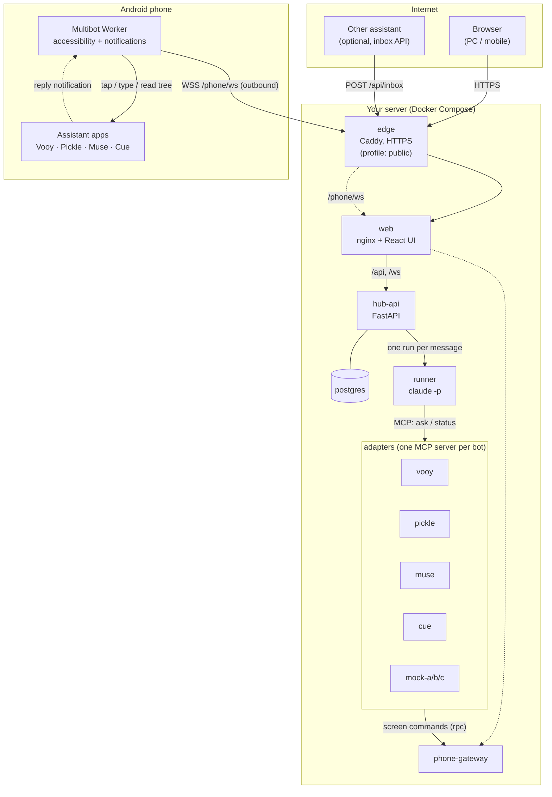
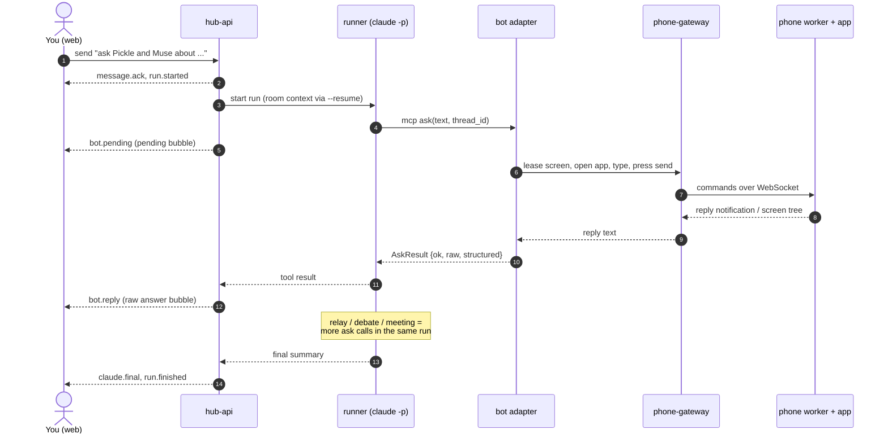
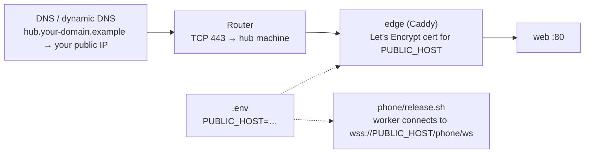
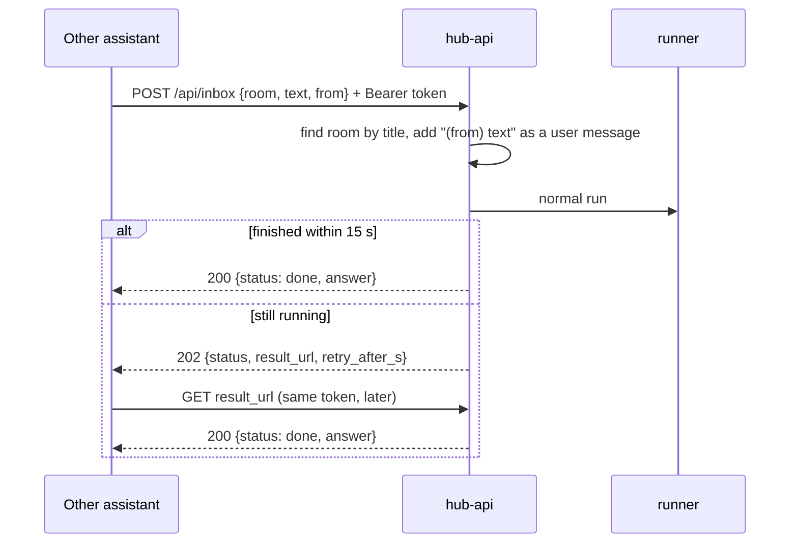

# Multibot Hub

[한국어](README.ko.md)

A personal hub that lets **Claude** orchestrate several consumer AI-assistant apps from one web page.
You type a message; Claude decides which assistants to ask, relays answers between them (relay, debate,
meeting), and writes a summary. The assistants are apps without public APIs, so the hub drives them on
an Android phone through an accessibility-service worker app.

> Single-user, self-hosted. Claude runs as headless **Claude Code** (`claude -p`) logged in with *your*
> subscription. Sharing the hub with other people would route their traffic through your subscription,
> which the Claude Code terms do not allow — switch the runner to an API key first if you want that.
> Driving third-party apps through accessibility automation is unofficial; check each app's terms.

## How it works



Only `edge` (or `web` locally) is reachable from outside. Adapters, runner and the gateway's internal API stay
on the Docker network, and the phone connects *outbound*, so it needs no open port.

### One message, step by step



- **hub/** – login (password + TOTP), sessions ("rooms"), run queue, WebSocket events, bot status panel,
  external inbox API.
- **runner/** – starts Claude Code per message with the orchestrator prompt (`runner/orchestrator.md`) and
  streams tool calls/answers back as events. Execution is capped at 600 s.
- **adapters/** – one MCP server per assistant (`ask`, `status`). Errors are returned as result fields,
  never as MCP exceptions. Per-app screen selectors live in `adapters/<bot>/selectors.yaml`.
  Includes mock bots (`mock-a/b/c`) for development and tests.
- **phone/** – the Android worker app (Java, no Gradle) and its build/release scripts.
- **web/** – React + TypeScript UI.
- **edge/** – optional Caddy front door with automatic HTTPS for your own domain.
- **docs/** – requirements, architecture, adapter contract, orchestrator, UI, roadmap (Korean).

## Requirements

- Docker with Compose v2
- GNU Make (optional; the targets are thin wrappers around `docker compose` / `uv` / `pnpm`)
- For development/tests: Python 3.12 + [uv](https://docs.astral.sh/uv/), Node.js + pnpm 10
- A Claude subscription that can use Claude Code
- For real assistants: an Android phone (Android 10+; 11+ recommended for screenshots) with the
  assistant apps installed and logged in
- For phone/remote access: **your own domain** (see below)

## Quick start (mock bots, local only)

```bash
cp .env.example .env            # then replace every change-me with random values
make up                         # postgres, hub-api, runner, web, phone-gateway, mock bots
                                # (real-bot adapters start too and stay unavailable until a phone connects)
make admin ARGS="create-operator --username me"   # prints a TOTP secret for your authenticator app
make runner-login               # log Claude Code in inside the runner container (once)
```

Open http://127.0.0.1:8080, sign in, create a room and try "ask mock-a and mock-b about tomorrow's weather".
Local ports are bound to 127.0.0.1 only (`docker-compose.override.yml`).

## Using your own domain

Everything public uses **one value in `.env`: `PUBLIC_HOST`**. No domain is stored in the repository, so
every user brings their own.



1. Point a DNS name at your public IP (any registrar or a dynamic-DNS provider works).
2. Forward TCP **443** on your router to the machine running the hub.
3. In `.env`:
   ```
   PUBLIC_HOST=hub.your-domain.example
   COMPOSE_PROFILES=public
   HUB_COOKIE_SECURE=true
   ```
4. `docker compose up -d` — the `edge` service (Caddy) obtains a Let's Encrypt certificate for
   `PUBLIC_HOST` and proxies to the web container.

If you prefer a tunnel or another reverse proxy, point it at the `web` container (port 80) and still set
`PUBLIC_HOST` so the phone release script knows the address.

## Connecting the phone

```bash
phone/release.sh
```

Builds the worker APK with your `PUBLIC_HOST` and device token, publishes it for auto-update, and prints a
**one-time, 30-minute** download link plus a QR code (`phone/dist/qr.png`). The APK contains the device
token: never commit it or share the link. On the phone, install it, allow restricted settings, then enable
the notification listener and the accessibility service (details in [phone/README.md](phone/README.md)).
Only one phone is connected at a time. Use a phone without a secure lock if you want the worker to wake
the screen by itself; it never unlocks a secure lock.

Then enable the real bots (`vooy`, `pickle`, `muse`, `cue`) in the hub's bot panel. Adding a bot is one
line in `hub/bots.yaml` plus an adapter folder — `hub/`, `runner/` and `web/` do not change.

## External inbox (optional)

Another assistant (for example one that can make HTTP requests) can post into a room at any time:



```
POST https://<PUBLIC_HOST>/api/inbox
Authorization: Bearer <HUB_INBOX_TOKEN>
{"room": "room title", "text": "message", "from": "pickle"}
```

- The room is matched by title (whitespace/case-insensitive, then a unique partial match). Unknown rooms
  return 404 with the list of room titles.
- The message is added as a user message and a normal run starts. The call waits up to 15 s: if the run
  finished, it returns `200 {"status": "done", "answer": ...}`; otherwise `202` with `result_url`. Fetch
  `GET <result_url>` with the same token later.
- Disabled unless `HUB_INBOX_TOKEN` is set. Limited to 10 posts/minute and 4000 characters.

## Development

```bash
make test        # hub, runner, adapters (unit + contract), web
make eval        # orchestrator evaluation with the real claude -p against mock bots (needs runner-login)
make types       # regenerate web/src/types/events.ts from hub/app/events.py
```

Contracts that must stay stable: the adapter MCP `ask`/`status` schemas (docs/03), the WebSocket event
envelope and type list (docs/05 §6), and the runner interface. See [CLAUDE.md](CLAUDE.md) for the working
rules used in this repo.

## Security notes

- Never commit `.env`, built APKs, or anything under `phone/dist/`. Secrets (adapter token, device token,
  inbox token, cookie key) are generated per installation.
- Internal services (adapters, runner, phone-gateway internal API) are reachable only on the Docker
  network; only the web container is exposed (and through `edge` when the `public` profile is on).
- Bot answers are untrusted text that flows into Claude's context. Claude is limited to the bots' `ask` /
  `status` tools (shell, file and web tools are disallowed), and the orchestrator prompt never confirms a
  payment or booking without your explicit approval in the next message.

## License

[MIT](LICENSE). This covers the whole repository, including the Android worker app in `phone/`.
