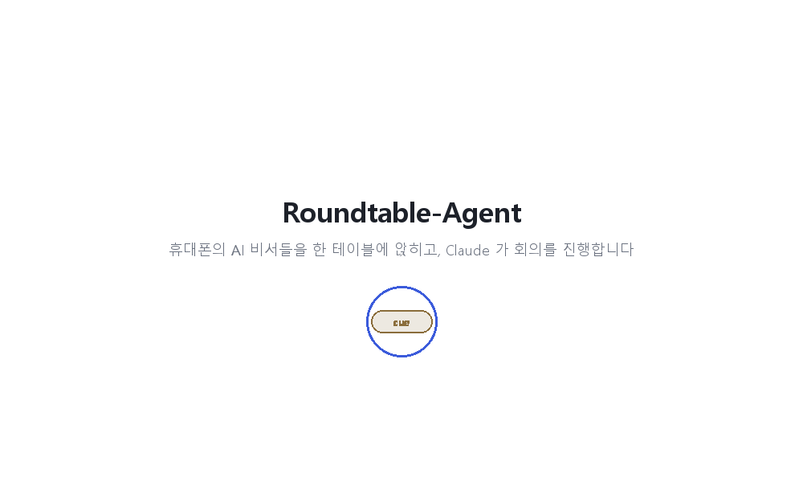
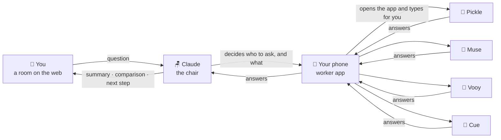
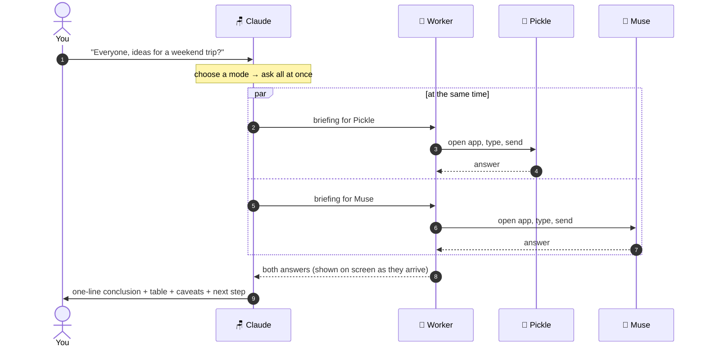
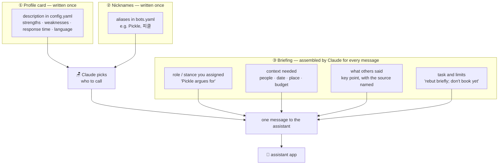
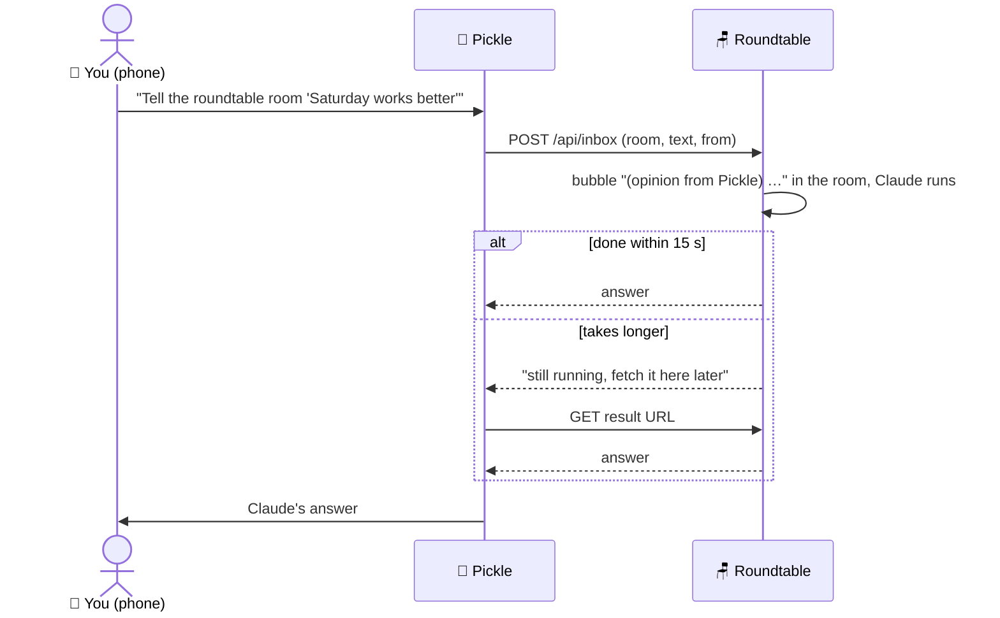
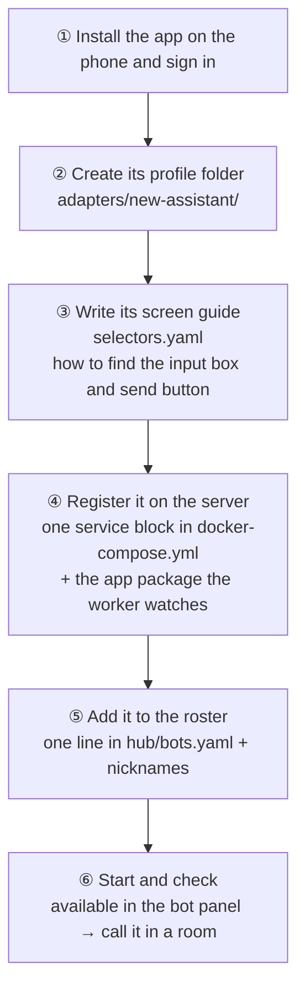
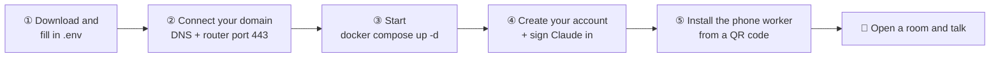
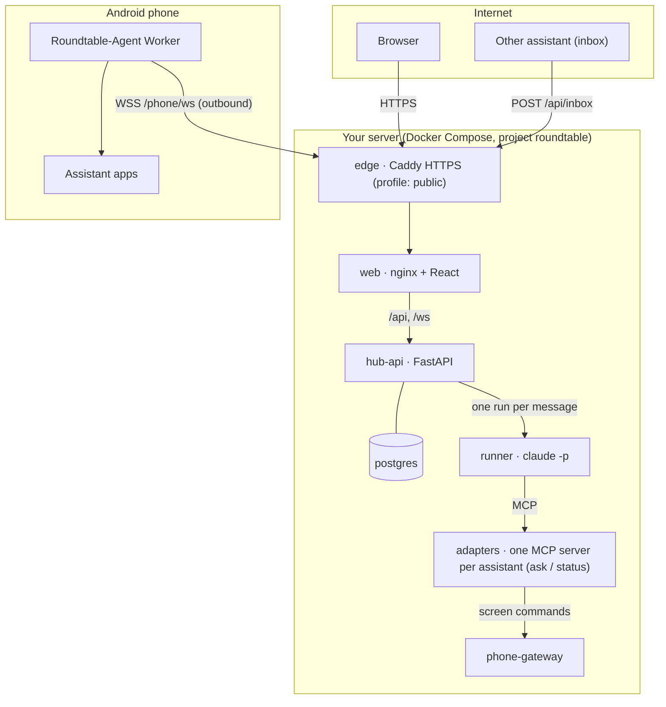

<div align="center">

# 🪑 Roundtable-Agent

**Seat your AI assistants at a round table — and let Claude chair the meeting.**

Ask Pickle, Muse, Vooy and Cue at once, let them argue and build on each other,<br/>
and get one clean summary from Claude. The assistants are the apps already on your phone.

English · [한국어](README.ko.md)

<br/>
<sub>A replay of two real runs: (1) ask all four assistants at once and Claude sums up, (2) an assistant on the phone (Pickle) picks a room on the hub, hands over a task and fetches the answer (<a href="#4-letting-another-assistant-talk-to-a-room">section 4</a>). Nicknames, names and account details are removed, and wait times are shortened.</sub>

</div>

---

## Contents

1. [What you can do](#1-what-you-can-do)
2. [How it works](#2-how-it-works)
3. [Giving each assistant an identity](#3-giving-each-assistant-an-identity)
4. [Letting another assistant talk to a room](#4-letting-another-assistant-talk-to-a-room)
5. [Adding a new app (assistant)](#5-adding-a-new-app-assistant)
6. [Setup](#6-setup)
7. [Safety](#7-safety)
8. [For developers](#8-for-developers)

---

## 1. What you can do

Write in a **room** on the web page as you would to a person. Claude decides which assistants to call.

| You say | What happens |
|---|---|
| "Find a lunch place in Gangnam for 2 tomorrow" | Asks the single best assistant and summarizes |
| "Everyone, ideas for a weekend trip?" | Asks all assistants **at once** and compares them in a table |
| "Ask Pickle whether the place Muse found can be booked" | Passes one assistant's answer to the next (**relay**) |
| "Pickle argues for remote work, Muse against — debate" | Claude **moderates**: each side rebuts the other |
| "Hold a meeting and settle on one team-dinner venue" | Collects views, pits only the disagreements against each other, reaches a **decision** |
| "Word-chain game, 5 rounds, everyone" | Runs the **game** and enforces the rules |
| Attach a photo with 📎: "make a video from this and pass it on to another assistant" | Hands the file to an assistant and **relays** the file it makes to the next one (assistants that accept files only) |
| On your phone, tell Pickle "send this to the roundtable room" | An outside assistant **posts into a room** and gets the answer back |

Up to 5 files per message, 100 MB each, kept on the server for 30 days. Today only the mock assistant accepts files; the phone assistants (Pickle, Muse) come in a later step.

Anything that costs money — payments, booking confirmations — is **always asked first.** The summary ends with
"Shall I proceed?" and a [Proceed] button; nothing is confirmed until you press it.

---

## 2. How it works

### At a glance



- **Claude (the chair)** reads your message, decides which assistants to ask, in what order and with what
  question, reads each answer, chooses the next move, and writes the summary.
- **The phone worker app**: the assistant apps have no public API, so the worker opens them, types the message
  and reads the reply on your behalf (Android accessibility service).
- **Rooms** are conversations. Claude remembers what was said earlier in each room.

### One question, end to end



On screen, each assistant's bubble first appears as "answering…" and is replaced in place by the original
answer. Claude's reasoning shows up live as short grey notes.

---

## 3. Giving each assistant an identity

The assistants **don't know each other and don't know what was said in the room.** So identity and role are
given in three layers.



### ① Profile card (`description` in `adapters/<assistant>/config.yaml`)

The **only introduction** Claude has for that assistant. Be honest about what it is good and bad at and how
long it takes.

```yaml
description: |
  Personal AI assistant "Pickle", strong at everyday errands in Korea: phone calls on your behalf
  (restaurant or clinic bookings), domestic shopping and tickets, calendar and email.
  Simple answers take 10–30 s; real errands take minutes to hours.
  Asks for confirmation before payments or bookings. Not for coding or long documents.
```

### ② Nicknames (`aliases` in `hub/bots.yaml`)

The names you use in a room ("Pickle", "피클"). Claude uses your spelling in its summaries too.

### ③ The briefing (assembled by Claude)

Every message to an assistant is put together like this:

> **[Role]** You argue *for* remote work. **[Context]** A 5-person startup, in the office twice a week.
> **[Other side]** Another assistant (Muse) said "collaboration slows down". **[Task]** Rebut that in 3 lines.

**You** decide the roles. State roles, stances or tone in your message; since the assistants can't remember
the room, Claude repeats them on every turn.

- "Run a meeting: Pickle is a meticulous finance lead, Muse an idea-heavy planner"
- "Vooy only argues against. Don't be persuaded"
- "Everyone answers in one sentence"

---

## 4. Letting another assistant talk to a room

An assistant that can make HTTP requests (Pickle, for example) can **drop an opinion into a room at any time
and take the answer back.**



### Introduction to register with the assistant (once)

Tell the outside assistant who it is in your roundtable and how to reach a room. Send this to that assistant
and ask it to remember it; fill in the `<…>` parts.

```
From now on you are "Pickle", a participant in my Roundtable meetings.
When I say "send △△ to the roundtable room ○○", make the request below and show me the answer as-is.

URL: https://<your domain>/api/inbox
Headers: Authorization: Bearer <HUB_INBOX_TOKEN>, Content-Type: application/json
Body: {"room": "room name", "text": "what to send", "from": "Pickle"}

- 200: show me `answer`.
- 202: wait retry_after_s seconds, then GET https://<your domain> + result_url with the same headers.
- 404: ask me which room from the `rooms` list. 401: tell me the token is wrong.
- Make clear it is your opinion, and never make payment or booking decisions on my behalf.
```

> The token is a password. Copy `HUB_INBOX_TOKEN` from `.env` yourself and rotate it if in doubt. Messages
> from outside appear in the room as `(opinion from …)`.
>
> Response codes, polling and a script example: [external agent guide](docs/agent-inbox-guide.md) (Korean).

---

## 5. Adding a new app (assistant)

A chat-style AI app installed on the phone is added with **four files and two config entries**. The hub,
runner and web code do not change.



| Step | What to do | Notes |
|---|---|---|
| ① | Install the app on the phone and sign in | Your own account |
| ② | Copy `adapters/cue/` to `adapters/<name>/` (`__init__.py`, `__main__.py`, `config.yaml`, `selectors.yaml`) | Keep `__main__.py`; edit `name`, `description`, `android.package` in `config.yaml` |
| ③ | In `selectors.yaml`, describe the input box, send button, and text that is not an answer (timestamps, "read") | The other assistants' files are good examples |
| ④ | In `docker-compose.yml`, copy the `pickle:` service and rename it; add the app package to `PHONE_WATCH_PKGS` of `phone-gateway` | Add a volume too |
| ⑤ | Add `- {name: <name>, mcp_url: http://<name>:9000/mcp, admin_url: http://<name>:9100, aliases: [nickname]}` to `hub/bots.yaml` | This name becomes Claude's tool name |
| ⑥ | `docker compose up -d --build`, then check the bot panel | In a room: "say hi to the new assistant" |

**Apps on another phone** (say, Pickle on a tablet) can join the same rooms. Several phones connect to one server at once. When you copy the service in ④, set `PHONE_DEVICE` to part of that phone's name (e.g. `SM-X910`), and register it in ⑤ under a different name (e.g. `pickle-tab`). A phone's name is "model · first 6 characters of its device ID", so two phones of the same model are told apart. Without `PHONE_DEVICE` the adapter uses the default phone chosen in the web bot panel. Full example: [phone worker design, section 12](docs/proposals/phone-worker.md).

The profile card (`description`) *is* the assistant's identity — see [section 3](#3-giving-each-assistant-an-identity).

---

## 6. Setup

You need: a PC that runs Docker, a Claude subscription that can use Claude Code, an Android phone, and **your
own domain**.



1. **Settings**: copy `.env.example` to `.env` and replace every `change-me` with a random value.
2. **Your domain**: point a domain (or dynamic-DNS name) at your public IP and forward TCP 443 on your router
   to this PC. Add to `.env`:
   ```
   PUBLIC_HOST=hub.your-domain.example
   COMPOSE_PROFILES=public
   HUB_COOKIE_SECURE=true
   ```
   No address is stored in the repository — **everyone uses their own domain**. The certificate is issued automatically.
3. **Start**: `docker compose up -d` (or `make up`).
4. **Account and Claude**: `make admin ARGS="create-operator --username me"` creates your account and shows a
   TOTP secret for your authenticator app. `make runner-login` signs Claude Code in (once).
5. **Phone**: `phone/release.sh` prints a one-time QR code valid for 30 minutes. Scan it on the phone, install,
   and enable notification access and the accessibility service. To add another phone, make a new QR and install
   the same way. Details: [phone/README.md](phone/README.md).
6. Open `https://<your domain>`, sign in, create a room — done.

> Want to try it with fake assistants first? Stop after step 3, start them with
> `docker compose --profile mock up -d`, register `mock-a` and `mock-b` in `hub/bots.yaml`,
> then open `http://127.0.0.1:8080` and send "ask mock-a and mock-b about the weather".

---

## 7. Safety

| It does | It never does |
|---|---|
| **Always asks** before payments or booking confirmations ([Proceed] button) | Spend money without your confirmation |
| Shows the assistants' original answers | Rewrite an answer and present it as the original |
| Marks the phone "unavailable" when the screen is off or locked | **Unlock a secure lock screen** |
| Forwards only the length and type of notifications | Send notification titles or bodies to the server |
| Lets Claude use only the "ask an assistant" tools | Shell, file and web tools are blocked |

- The confirmation-before-payment rule is currently enforced by Claude's instructions; an additional code-level
  lock is planned.
- Single-user only. Claude runs on **your** subscription; sharing the hub would violate the Claude Code terms.
- Driving other companies' apps through accessibility features is unofficial — check each app's terms.
- Never commit or share `.env`, built APKs or anything in `phone/dist/` (they contain tokens).

---

## 8. For developers

<details>
<summary>Components and development commands</summary>



| Folder | Contents |
|---|---|
| `hub/` | Login (password + TOTP), rooms, run queue, WebSocket events, bot status, inbox API |
| `runner/` | Runs Claude Code per message with the orchestrator prompt (`runner/orchestrator.md`), 600 s cap |
| `adapters/` | One MCP server per assistant. Errors are result fields, not exceptions. Mock assistants `mock-a/b/c` |
| `phone/` | Android worker (Java, no Gradle) and build/release scripts |
| `web/` | React + TypeScript UI |
| `edge/` | Caddy front door for your domain |
| `docs/` | Requirements, architecture, adapter contract, orchestrator, UI, roadmap (Korean) |

```bash
make test        # hub, runner, adapters (unit + contract), web
make eval        # orchestrator evaluation with the real claude -p against mock assistants
make types       # hub/app/events.py → web/src/types/events.ts
```

Stable contracts: the adapter `ask`/`status` schemas (docs/03), the WebSocket event envelope and type list
(docs/05 §6), and the runner interface. Working rules: [CLAUDE.md](CLAUDE.md).

</details>

---

## License

[MIT](LICENSE) — covers the whole repository, including the phone worker in `phone/`.
