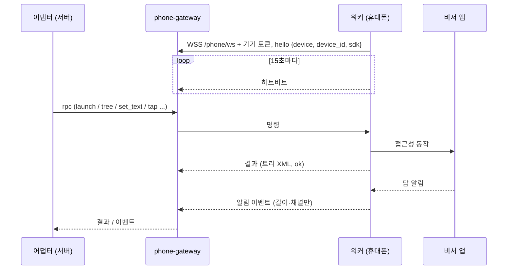
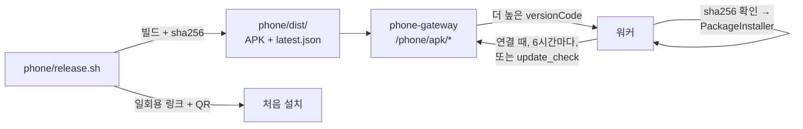

# Roundtable-Agent 워커 (휴대폰 앱)

[English](README.md)

사용자 휴대폰에서 Vooy·피클·뮤즈 앱을 접근성 서비스로 조종하는 안드로이드 앱이다(docs/proposals/phone-worker.md, ADR-9).
허브의 폰 게이트웨이에 바깥으로 WebSocket 연결(`wss://<허브 주소>/phone/ws`)하고, 게이트웨이가 보내는 범용 명령
(`adapters/phone/protocol.py`의 COMMANDS)을 수행한다. 봇별 판단은 서버 어댑터가 한다. 앱이 바뀌어도 서버의 `selectors.yaml`만 고친다.

## 연결 구조



### 자동 업데이트



## 빌드

Gradle 없이 Android SDK build-tools와 Android Studio JDK로 빌드한다.

```bash
PHONE_WS_URL=wss://hub.example/phone/ws PHONE_DEVICE_TOKEN=<.env 의 값> phone/build.sh <출력 폴더>
```

두 env는 앱의 기본 설정값이 된다(앱 화면에서 바꿀 수 있다). 토큰이 APK 안에 들어가므로 빌드한 APK는 레포에 넣지 않고 본인 휴대폰에만 설치한다.

## 배포와 자동 업데이트

```bash
phone/release.sh   # .env 의 PUBLIC_HOST(각자의 도메인)로 https://<PUBLIC_HOST> 를 쓴다
```

다른 주소로 배포할 때만 `PHONE_PUBLIC_URL=https://<주소> phone/release.sh`처럼 덮어쓴다.

- 빌드(버전 번호는 2026-01-01부터 초 단위) → `phone/dist/`에 게시. `phone-gateway`가 이 폴더를 읽어 워커 자동 업데이트에 쓴다.
- 30분 동안 한 번만 쓰는 설치 링크와 QR(`phone/dist/qr.png`)을 만든다. APK 안에 기기 토큰이 있어 공개 링크는 두지 않는다.
  안드로이드 브라우저는 다운로드 관리자가 같은 주소를 한 번 더 부르므로, 처음 받은 뒤 2분 동안만 다시 받을 수 있다.
- 연결된 휴대폰마다 `update_check`를 보낸다. 워커는 연결될 때와 6시간마다 스스로도 확인한다.
- 워커는 새 버전을 기기 토큰으로 내려받아 SHA-256을 확인하고 PackageInstaller로 설치한다. 안드로이드 14+는
  `UPDATE_PACKAGES_WITHOUT_USER_ACTION` 권한 덕에 확인 창 없이 설치되고, 설치 뒤 접근성 서비스가 다시 켜져 저절로 다시 연결한다
  (에뮬레이터 API 34에서 확인). 서버 주소가 바뀐 배포는 이전 주소로 닿지 않으므로 QR로 다시 설치한다.

## 설치와 권한 (처음 한 번)

1. APK 설치(출처를 알 수 없는 앱 허용).
2. 앱 → "앱 정보 열기" → ⋮ → "제한된 설정 허용"(안드로이드 13+에서 직접 설치한 앱은 이걸 해야 다음 두 권한을 켤 수 있다).
3. "알림 접근 설정 열기" → Roundtable-Agent 워커 알림 켜기.
4. "접근성 설정 열기" → 설치된 앱 → Roundtable-Agent 워커 켜기. 켜지면 바로 게이트웨이에 연결한다(앱 화면을 닫아도 된다).

## 동작

- 연결: 끊기면 1→30초 지수 백오프로 다시 붙는다. 하트비트 15초.
- 여러 휴대폰: 게이트웨이 하나에 여러 대가 함께 붙는다. 이름은 "모델 · `ANDROID_ID` 앞 6자"이고 화면 차례·알림은 폰마다 따로다. 어댑터는 `PHONE_DEVICE`로 폰을 고르고, 없으면 기본 폰을 쓴다.
- 명령: `state`(화면·잠금·전경 앱·키보드 위치), `watch`, `launch`(런처 인텐트), `tree`(앱 창의 접근성 트리를 uiautomator dump 형식 XML로), `tap`, `set_text`, `paste`(붙여넣은 뒤 클립보드 비움), `global`(home·back), `screenshot`(안드로이드 11+).
- 알림: `watch`로 받은 앱(Vooy·피클·뮤즈)의 알림만 이벤트로 올린다. 제목·본문은 보내지 않고 길이·채널만 보낸다.
- 화면 기록에는 명령 이름·상태만 남기고 메시지 내용은 남기지 않는다.

개인 휴대폰 기준이다. 화면이 꺼졌거나 잠겨 있으면 어댑터가 `backend_down`으로 보고하고 조종하지 않는다.

## 첨부 (파일 넣기·가져오기)

피클·뮤즈 어댑터가 쓴다(docs/03-adapters.md 2장 첨부). 파일은 폰 게이트웨이의 임시 중계(15분)로만 오가고 워커에 남지 않는다.

- **넣기**: 워커가 `share` 명령으로 파일을 받아(`GET /phone/files/<code>`, 기기 토큰) 공유하기로 봇 앱을 연다. 이어서 어댑터가 글을 보낸다.
  종류는 가리지 않는다. 봇 앱의 공유하기가 그 종류를 받지 않으면 워커가 열기 전에 알아채고 어댑터는 `unsupported` 로 답한다.
- **가져오기**: `media_since` 로 질문하는 동안 그 봇 앱(또는 내려받기 관리자)이 저장한 사진·영상·소리와 내려받기·문서 폴더의 파일을 찾고, `media_upload` 로 게이트웨이에 올린다(`POST /phone/files`).
  워커 화면을 열면 **사진·영상 읽기** 권한을 묻는다. 허용해야 가져오기가 된다(워커 화면의 "사진·영상 읽기: 허용됨").
  내려받은 문서(PDF 등): 안드로이드 10(노트9)은 그대로 된다. 11 이상은 워커 화면의 **모든 파일 접근 설정 열기**로 켜야 한다.
- 봇 앱은 결과 그림을 채팅에만 보여 준다. 어댑터가 그 그림을 눌러 앱의 저장 버튼(selectors.yaml `save_media`)을 눌러 저장한 뒤 가져온다. 저장 버튼이 없는 결과(링크로만 주는 영상 등)는 아직 못 가져온다.

## 원탁 앱 (phone/client)

원탁 웹 화면을 감싼 안드로이드 앱(`dev.roundtable.app`, 이름 "원탁")이다. 봇을 조종하는 워커와 다른 앱이고, 토큰은 들어 있지 않다.

```bash
phone/client/release.sh   # .env 의 PUBLIC_HOST 로 https://<PUBLIC_HOST>/ 를 연다
```

- 빌드 결과는 `phone/dist/roundtable.apk`. `phone-gateway` 의 `POST /apk/link?app=client` 로 30분짜리 일회용 링크를 받아 QR(`phone/dist/roundtable-qr.png`)을 만든다.
- 로그인은 웹과 같다(비밀번호·인증 코드). 쿠키는 앱 안에 남는다.
- 📎 는 안드로이드 파일 고르기 창(여러 개 가능), 파일 내려받기는 다운로드 관리자(로그인 쿠키를 함께 넘김)로 한다. 원탁 주소 밖 링크는 브라우저로 연다.
- 자동 업데이트는 없다. 새 버전은 QR 로 다시 설치하면 덮어써진다(같은 디버그 서명).
