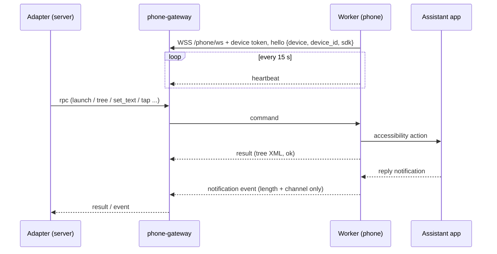
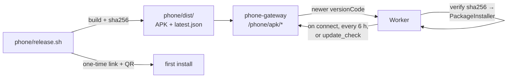

# Roundtable-Agent Worker (phone app)

[한국어](README.ko.md)

An Android app that drives the Vooy, Pickle and Muse apps on your phone through an accessibility service
(docs/proposals/phone-worker.md, ADR-9). It opens an outbound WebSocket to the hub's phone gateway
(`wss://<hub address>/phone/ws`) and executes the gateway's generic commands (COMMANDS in
`adapters/phone/protocol.py`). All bot-specific decisions are made by the server-side adapters; when an app
changes, only the server's `selectors.yaml` needs updating.

## How it connects



### Auto-update



## Build

Built without Gradle, using the Android SDK build-tools and the Android Studio JDK.

```bash
PHONE_WS_URL=wss://hub.example/phone/ws PHONE_DEVICE_TOKEN=<value from .env> phone/build.sh <output dir>
```

The two variables become the app's default settings (they can be changed in the app). The token is embedded
in the APK, so never commit a built APK; install it only on your own phone.

## Release and auto-update

```bash
phone/release.sh   # uses https://<PUBLIC_HOST> from .env (your own domain)
```

Override with `PHONE_PUBLIC_URL=https://<address> phone/release.sh` only when releasing to a different address.

- Builds (version code = seconds since 2026-01-01) and publishes to `phone/dist/`. `phone-gateway` serves
  this folder for worker auto-updates.
- Creates a one-time install link valid for 30 minutes and a QR code (`phone/dist/qr.png`). Because the APK
  contains the device token, there is no public download link. Android browsers hand the download to the
  download manager, which requests the same URL again, so the link can be fetched again for 2 minutes after first use.
- Sends `update_check` to every connected phone. The worker also checks by itself on connect and every 6 hours.
- The worker downloads the new version with its device token, verifies the SHA-256 and installs it with
  PackageInstaller. On Android 14+ the `UPDATE_PACKAGES_WITHOUT_USER_ACTION` permission lets it install
  without a prompt; the accessibility service comes back on after the update and reconnects by itself
  (verified on an API 34 emulator). A release that changes the server address cannot reach phones still
  using the old address, so reinstall from the QR code.

## Install and permissions (first time)

1. Install the APK (allow apps from unknown sources).
2. In the app → "Open app info" → ⋮ → "Allow restricted settings" (on Android 13+, sideloaded apps need this
   before the next two permissions can be turned on).
3. "Open notification access settings" → enable notifications for Roundtable-Agent Worker.
4. "Open accessibility settings" → Installed apps → enable Roundtable-Agent Worker. It connects to the gateway as soon
   as it is enabled (you can close the app screen).

## Behavior

- Connection: reconnects with exponential backoff from 1 to 30 seconds. Heartbeat every 15 seconds.
- Several phones: one gateway accepts several phones at once. Each is named "model · first 6 characters of `ANDROID_ID`"
  and has its own screen turns and notifications. An adapter picks a phone with `PHONE_DEVICE`, otherwise the default phone.
- Commands: `state` (screen, lock, foreground app, keyboard position), `watch`, `launch` (launcher intent),
  `tree` (the app window's accessibility tree as uiautomator-dump XML), `tap`, `set_text`, `paste` (clears the
  clipboard after pasting), `global` (home, back), `screenshot` (Android 11+).
- Notifications: only notifications from apps passed to `watch` (Vooy, Pickle, Muse) are reported as events.
  Titles and bodies are never sent, only length and channel.
- The on-screen log keeps only command names and status, never message content.

Designed for a personal phone. If the screen is off or locked, the adapter reports `backend_down` and does
not operate the phone.
